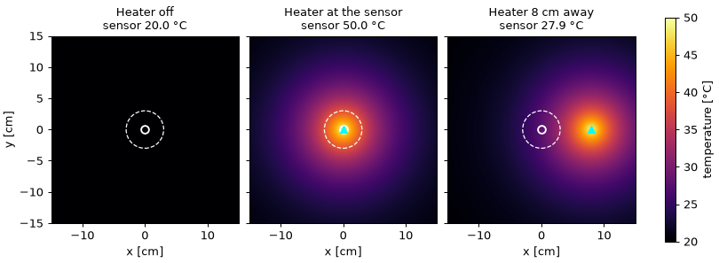
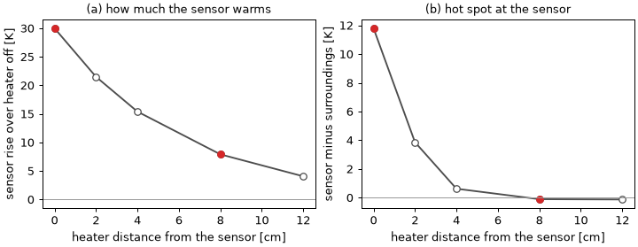

# ヒーターを離して置いても、センサーの温度は上がるか

> これは `runops-analyze` skill に同梱した書き方の見本です。数値は
> `scripts/make_figures.py` が作る模擬データで、実在の計算結果ではありません。
> run id などの再現情報も、書く場所を示すための例です。

## 調べたことと結果

金属板の中央に温度センサーがあり、板の上にヒーターを 1 個置きます。ヒーターを
センサーの真上に置けばセンサーが温まるのは当然ですが、知りたいのは、ヒーターを
センサーから離して置いたときです。センサーの温度は上がるのか。上がるなら、それは
センサーだけが局所的に熱せられているのか、板の広い範囲が温まった結果なのか。

ヒーターの出力（10 W）と板の条件は固定し、ヒーターとセンサーの距離だけを 0 cm から
12 cm まで変えました。比較の基準は、ヒーターを切った計算です。

結果は次のとおりです。ヒーターを 8 cm 離しても、センサーの温度は基準より約 8 K
高くなりました。このときセンサーとその周囲の温度はほぼ同じで、センサーだけが熱い
状態にはなっていません。離れたヒーターは、板の広い範囲を温めることを通して
センサーの温度を上げています。

## 温度分布を並べて見る

まず、板全体の温度がどう変わるかを見ます。図 1 は、ヒーターを切った場合、センサーの
真上に置いた場合、8 cm 離して置いた場合の温度分布を、同じ範囲と同じ色尺度で並べた
ものです。色が明るいほど高温で、白い丸がセンサー、水色の三角がヒーターの位置です。
白い破線の円（半径 3 cm）は、あとで「センサーの周囲」として温度を平均する範囲を
示しています。どの分布も、計算が定常に達した後の最後の 1000 step の平均です。

左の図は一様に 20 °C で、これが比較の基準です。中央の図では、ヒーターを中心に
温度が上がり、センサーは 50 °C と板の中で最も高温になっています。右の図では高温の
中心がヒーターとともに右へ移りますが、温まった範囲はセンサーの位置まで広がって
おり、センサーは 27.9 °C を示します。破線の円の中を見ると、中央の図では円の中心が
周りより明らかに明るいのに対し、右の図では円の中に目立った明暗がありません。

つまり、離れたヒーターでもセンサーの温度は上がりますが、その上がり方は直上に置いた
場合と違い、センサーの位置が特別に熱いわけではないように見えます。ただし図 1 は
2 つの距離しか示していません。次に、距離を細かく変えてこの見方を確かめます。

## 距離を変えたときの変化

図 2 は、ヒーターとセンサーの距離を横軸にとり、2 つの量を示しています。(a) は
センサーの温度が基準（ヒーターなし）からどれだけ上がったか、(b) はセンサーの温度から
周囲（図 1 の破線の円周上）の平均温度を引いた値です。(b) が正で大きいほど、
センサーの位置だけが局所的に熱いことを表し、0 に近ければセンサーは周囲と同じ温度
です。赤い点は図 1 で分布を示した 2 つの距離です。

(a) の温度上昇は距離とともにゆるやかに小さくなり、8 cm で 7.9 K、12 cm でも 4.1 K
残ります。一方、(b) の周囲との差は 0 cm の 11.8 K から急に小さくなり、4 cm で 0.6 K、
8 cm 以上ではほぼ 0（−0.1 K）です。

| 距離 [cm] | センサーの温度上昇 [K] | センサー − 周囲 [K] |
|---|---|---|
| 0 | 30.0 | 11.8 |
| 2 | 21.5 | 3.9 |
| 4 | 15.4 | 0.6 |
| 8 | 7.9 | −0.1 |
| 12 | 4.1 | −0.1 |

2 つの量が違う速さで小さくなることが、最初の問いへの答えです。ヒーターを 4 cm 以上
離すと、センサーの温度はまだ 15 K 上がっているのに、周囲との差はほとんど消えます。
この距離では、センサーはヒーターに直接熱せられているのではなく、温まった板と同じ
温度になっています。

この結果からは判断できないこともあります。保存したのは板の温度分布だけなので、
熱が板の中を伝わってセンサーに届いたのか、板の上の空気を通って届いたのかは
区別できません。「板の広い範囲が温まる」という説明は分布の形から言えることで、
熱の経路ごとの寄与を分けた結果ではありません。

## 再現情報

| 条件 | run | 計算コード | 平均した区間 |
|---|---|---|---|
| ヒーターなし（基準） | `R20261101-0001` | plate-sim 1.4.2 | step 9001–10000 |
| 距離 0, 2, 4, 8, 12 cm | `R20261101-0002` – `0006` | plate-sim 1.4.2 | step 9001–10000 |

- 6 本とも同じ版・同じ格子・同じ step 数の計算で、違いはヒーターの有無と位置だけです。
  センサーの温度が最後の 1000 step で 0.01 K 以内に収まっていることを確認し、
  その区間を平均しました。
- 図に平滑化やマスクは使っていません。「周囲」は、センサーを中心とする半径 3 cm の
  円周上の 720 点の平均です。
- 図と表は `scripts/make_figures.py` が作ります。図 2 と表の元の数値は
  [out/values.csv](out/values.csv) にあります。
- `report.html` は `scripts/build_html.py` がこの README から作る、図を埋め込んだ
  単体で読めるファイルです。

## 確認記録

- ファイル: `python scripts/build_html.py --check` が、`report.html` が README と一致し、
  画像 2 枚を埋め込んでいると報告しました。
- 図の内容: 2 枚の PNG を開き、軸ラベル、色尺度、各列の条件名と温度の文字が読めること、
  表の値と図 2 の点が一致することを確認しました。
- ブラウザ表示: `report.html` をブラウザで開いた確認はしていません。
